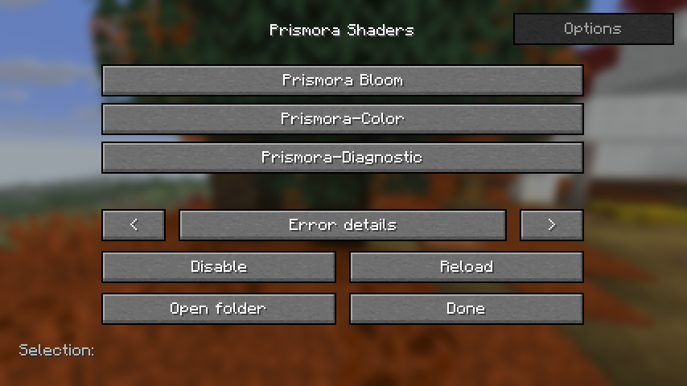

# Prismora

Mod de postproceso para **Minecraft Java 26.3 + Forge 66.1.0 + Java 25**, solo cliente.

Selecciona shaderpacks propios desde Ajustes de vídeo o con **F6** (configurable en Controles). Permite carpetas y ZIP, varias pasadas, bloom, datos dinámicos del mundo, opciones persistentes y recarga automática al editar el pack.



## Instalar

1. Instala Java 25 y Forge 66.1.0 para Minecraft 26.3.
2. Copia `prismora-0.2.0.jar` a `mods/` en el directorio de tu instalación de Minecraft.
3. Copia una carpeta de `examples/`, o uno de los ZIP de distribución, directamente a `shaderpacks/`. Puedes abrir esa carpeta desde Prismora.
4. Abre Ajustes de vídeo → Prismora, o pulsa F6 dentro del mundo, y selecciona el pack. El asterisco y el estado indican la selección activa. Usa Desactivar para volver al render sin Prismora.

`Prismora-Color` ajusta color; `Prismora-Bloom` añade bloom con intensidad configurable. `Prismora-Diagnostic` y `Prismora-Multipass` producen un color de prueba y sirven para verificar GPU, no para jugar.

Los cambios de shader se recargan tras un breve debounce. Los parámetros se guardan por pack en `config/prismora.json`. Ante un error de compilación se desactiva el shader; consulta Detalles del error o `logs/latest.log`.

## Calidad y rendimiento

Abre **Prismora → Rendimiento**. Elige un perfil o personaliza escala, bloom, objetivo FPS, adaptación y fallback; pulsa **Aplicar**.

| Perfil | Escala de postproceso | Bloom del ejemplo | Objetivo |
|---|---:|---|---:|
| Entrada | 50% por eje | Desactivado, sin ejecutar sus pasadas | 30 FPS, adaptativo |
| Baja | 50% por eje | Activado con buffers reducidos | 30 FPS |
| Media | 75% por eje | Activado | 60 FPS |
| Alta | 100% | Activado | 60 FPS |

Son presets elegidos por el jugador, no una clasificación automática de GPU. La escena vanilla sigue a la resolución de ventana. Los efectos opcionales de cada pack deben declarar su bypass para que Prismora pueda eliminarlos correctamente.

El modo adaptativo evalúa tiempos de GPU y de frame, espera calentamiento y presión sostenida y tiene un cooldown de 30 segundos. Reduce escala/efectos por etapas; esos cambios recargan recursos y no son una resolución dinámica continua por frame. Si en el mínimo sigue sin cumplir el presupuesto, puede pausar el shader conservando la selección. **Recargar** o aplicar un perfil lo reactiva. No reduce calidad por un límite de CPU/VSync aislado.

30 FPS es un objetivo, no una garantía: si vanilla ya va por debajo de 30, este mod no sustituye un optimizador de chunks. Las pruebas realizadas en RTX 5060 Ti no prueban tarjetas de entrada o integradas. [Mediciones y matriz de hardware](docs/RENDIMIENTO.md).

En **Opciones** del pack hay sliders, interruptores y listas de valores cuando el pack los declara. Se editan como borrador; **Aplicar** guarda todos los cambios y recompila una vez. Salir sin aplicar descarta el borrador.

## Alcance actual

- Probado en OpenGL y Vulkan en el equipo de desarrollo NVIDIA; el resultado en otros equipos necesita su propia validación.
- Usa abstracciones de GPU y postproceso de Mojang, sin llamadas OpenGL directas.
- Formato propio: no carga packs OptiFine/Iris sin adaptación.
- El pack activo tiene prioridad sobre otros recursos `minecraft:end_of_frame`; no combina automáticamente esos efectos. Al desactivarlo se retira el pack interno.
- No incluye G-buffer por material ni sombras solares, ni sustituye el render de agua, cielo o nubes. [Investigación de geometría](docs/GEOMETRIA.md).
- El código original no tiene una licencia abierta elegida; conserva todos los derechos. Los archivos de Forge conservan sus licencias originales.

## Desarrollo y pruebas

```powershell
.\gradlew.bat build
.\gradlew.bat runClient
.\scripts\Test-Prismora.ps1 -Backend opengl
.\scripts\Test-Prismora.ps1 -Backend vulkan
.\scripts\Test-PackagedClient.ps1 -Backend vulkan
.\scripts\Test-PackagedClient.ps1 -Backend opengl -Probe performance
.\scripts\Test-PackagedClient.ps1 -Backend vulkan -Probe performance
.\scripts\Build-Distribution.ps1
```

Las pruebas de cliente abren Minecraft y un mundo local de prueba, activan efectos, leen píxeles de GPU, fuerzan un error de GLSL, verifican opciones y recarga automática y cierran el juego. Usan `run/` o `.gradle/packaged-smoke/run/`, no tu instalación habitual. No ejecutes dos probes simultáneamente sobre el mismo directorio.

GitHub Actions compila y ejecuta las pruebas unitarias en cada push y pull request. Las pruebas de GPU se ejecutan localmente con los scripts; CI no demuestra compatibilidad de render.

El JAR se genera en `build/libs/`; la distribución en `dist/`. Los scripts comprueban marcadores de éxito y el backend efectivo para detectar fallback. [Resultados y límites de pruebas](docs/VALIDACION.md).

[Planeación](PLANEACION.md) · [Formato de packs](docs/FORMATO_PACKS.md) · [Publicación](docs/PUBLICACION.md)
